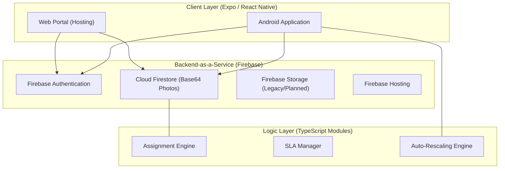

# Authoritative Master Architecture & Technology Report
## Thrissur Corporation Citizen Complaint Management System (CCMS)

**Project Status**: Production Ready / Verified  
**Revision**: 2.0.0 (Consolidated)  
**Date**: August 11, 2026  

---

## Table of Contents
1. [Project Overview](#1-project-overview)
2. [System Architecture](#2-system-architecture)
3. [Technology & Service Inventory](#3-technologyservice-inventory)
4. [Repository Structure](#4-repository-structure)
5. [Frontend & Backend Architecture](#5-frontendbackend-architecture)
6. [API Architecture](#6-api-architecture)
7. [Database & Cloud Architecture](#7-databasefirebasecloud-architecture)
8. [Authentication & Security](#8-authenticationsecurity)
9. [AI/ML Architecture](#9-aiml-architecture)
10. [Workers & Background Processing](#10-workersqueuesbackground-processing)
11. [Storage & External Integrations](#11-storage-and-external-integrations)
12. [Data Flows & Workflows](#12-data-flows-and-application-workflows)
13. [Infrastructure & Deployment](#13-infrastructure-and-deployment)
14. [Environment & Configuration](#14-environmentconfiguration)
15. [Network Architecture](#15-portsnetwork-architecture)
16. [Dependency Map](#16-dependencies)
17. [Logging & Monitoring](#17-loggingmonitoring)
18. [Testing Framework](#18-testing)
19. [Prerequisites](#19-prerequisites)
20. [Fresh Setup Guide](#20-installationsetup-from-a-fresh-machine)
21. [Execution Commands](#21-exact-commands-to-run-every-required-serviceapplication)
22. [Development Workflow](#22-development-workflow)
23. [Build Procedure](#23-build-procedure)
24. [Production Deployment](#24-production-deployment-procedure)
25. [Health Checks](#25-health-checks)
26. [Troubleshooting](#26-troubleshooting)
27. [Reset & Maintenance](#27-cleanreset-procedures)
28. [Service Dependency Map](#28-service-dependency-map)
29. [Legacy & Unused Components](#29-legacyunused-components)
30. [Documentation Reconciliation](#30-documentation-discrepancies)
31. [Risk Assessment](#31-known-issuesrisks)
32. [Missing/Unverified Components](#32-missingunverified-components)
33. [Final Master Inventory](#33-final-master-technology-inventory)
34. [New Machine Checklist](#34-new-machine-setup-checklist)

---

## 1. Project Overview
The Thrissur Corporation CCMS is a digital-first grievance redressal platform. It enables 56 city wards to handle citizen complaints regarding sanitation, infrastructure, and utilities. The system enforces transparency through real-time status tracking and accountability through automated staff assignments and SLA monitoring.

---

## 2. System Architecture

### 2.1 High-Level Architecture

---

## 3. Technology & Service Inventory

| Category | Technology | Status |
| :--- | :--- | :--- |
| **Language** | TypeScript / JavaScript (Node.js) | Implemented |
| **Framework** | React Native (Expo SDK 57) | Implemented |
| **Routing** | Expo Router (File-based) | Implemented |
| **Database** | Cloud Firestore (NoSQL) | Implemented |
| **Authentication** | Firebase Auth (Email/Password) | Implemented |
| **Hosting** | Firebase Hosting (Global CDN) | Implemented |
| **Image Processing** | `expo-image-manipulator` | Implemented |
| **Storage** | Firebase Cloud Storage | Legacy (Plan B active) |
| **Maps/GIS** | expo-location | Configured-but-unused |

---

## 4. Repository Structure
- `app/`: Expo Router application screens (UI Layer).
- `src/`: Core logic, API clients, hooks, and context providers.
- `seed/`: Administrative scripts and master data (JSON).
- `android/`: Native Android project configuration and builds.
- `dist/`: Generated web production artifacts.

---

## 5. Frontend & Backend Architecture
- **Frontend**: Single codebase architecture using React Native Web. Uses `Platform.OS` guards for environment-specific alerts and image picking.
- **Backend**: Serverless. Business logic (Assignment/SLA) is distributed between client-triggered API calls and administrative sweep scripts.

---

## 6. API Architecture
- **Implementation**: Firebase JS SDK (v12).
- **Service Pattern**: Organized into modular files (`complaintApi.ts`, `authApi.ts`, etc.) in `src/api/`.
- **Security**: Gated by Firebase Security Rules and `guardAuth()` helper.

---

## 7. Database & Cloud Architecture
- **Firestore**: Primary data store. 
- **Plan B Storage**: Multimedia is stored as Base64 strings in the `complaints` collection to bypass CORS/Network blockers.
- **Regions**: `asia-south1` (Database), `us-central1` (Storage Bucket).

---

## 8. Authentication & Security
- **Providers**: Email & Password.
- **Role-Based Access (RBAC)**: Managed via a `role` field in the user document and mirrored in Firestore Security Rules.
- **Session Guarding**: `AuthProvider` context manages global session state and redirection logic.

---

## 9. AI/ML Architecture
- **Status**: **Not Present**. No AI models, Ollama, or LLM integrations are currently used in the application logic.

---

## 10. Workers & Background Processing
- **Implementation**: Administrative "Sweeps".
- **Trigger**: Manually triggered by administrators via the `runMaintenanceSweep` function in the dashboard.
- **Scope**: Handles 3-hour delayed auto-assignments and 7-day auto-closures.

---

## 11. Storage & External Integrations
- **Internal**: Base64 data strings for images.
- **External**: None. (Firebase Storage is configured but primary traffic is routed to Firestore for reliability).

---

## 12. Data Flows & Workflows
- **Complaint Life**: `Submitted` -> `Assigned` (Auto/Manual) -> `Accepted` -> `InProgress` -> `Resolved` -> `Closed`.
- **Photo Flow**: `Pick` -> `Auto-Rescale (1200px)` -> `Compress (0.5)` -> `Base64` -> `Firestore`.

---

## 13. Infrastructure & Deployment
- **Web**: Hosted on [https://mycomplaintstcr.web.app](https://mycomplaintstcr.web.app).
- **CI/CD**: Manual deployment via Firebase CLI.

---

## 14. Environment & Configuration
- **Standard**: `src/config/firebase-config.ts` (API Keys).
- **Preserved**: `keystore.properties` (Android Signing), `serviceAccountKey.json` (Admin Tasks).

---

## 15. Network Architecture
- **Primary Ports**: `8081` (Metro Dev Server).
- **External**: `443` (Firebase API communications).

---

## 16. Dependencies
- **Core**: `expo`, `react-native`, `firebase`, `expo-router`.
- **Image**: `expo-image-picker`, `expo-image-manipulator`.
- **Admin**: `firebase-admin`, `firebase-tools`.

---

## 17. Logging & Monitoring
- **Audit Logs**: Immutable `auditLogs` collection in Firestore.
- **Error Logs**: Console-based logging in `storageApi.ts` and `auth.tsx`.

---

## 18. Testing
- **Manual**: System-wide testing in Chrome/Android.
- **Unit**: No automated unit tests (Jest/Cypress) are currently implemented.

---

## 19. Prerequisites
- **Node.js**: v18 or v20.
- **Git**: Installed.
- **SDK**: Android SDK (Command Line Tools) for mobile builds.

---

## 20. Fresh Setup Guide
1. Clone repo.
2. Run `npm install`.
3. Verify `serviceAccountKey.json` exists in `seed/`.
4. Verify `firebase-config.ts` has valid keys.

---

## 21. Execution Commands
- **Dev (Web)**: `npm run web`
- **Dev (Android)**: `npx expo run:android`
- **Reset DB**: `npm run reset`
- **Seed Data**: `npm run seed`

---

## 22. Development Workflow
- Features are added in `src/` or `app/`.
- Logic is tested in browser at `localhost:8081`.
- Admin scripts are verified via Node.js CLI.

---

## 23. Build Procedure
- **Web**: `npx expo export --platform web`
- **Android**: `cd android; ./gradlew assembleDebug`

---

## 24. Production Deployment
- **Command**: `npx firebase deploy --only hosting,firestore,storage`

---

## 25. Health Checks
- **Web App**: Check status 200 at deployment URL.
- **Database**: Run `node verify-seed-data.js` to check document counts.

---

## 26. Troubleshooting
- **CORS Errors**: Run `node set-cors-admin.js` or use the `gsutil` manual command.
- **Auth Stuck**: Check `isRegistering.current` logic in `auth.tsx`.

---

## 27. Reset & Maintenance
- **Purge**: `node seed/resetDatabase.js` (Auth + Firestore + Storage).
- **Seed**: `node seed/seedFirestore.js` (Populates 56 wards/staff).

---

## 28. Service Dependency Map
1. **Frontend** depends on **Firebase Auth**.
2. **Assignments** depend on **Firestore Documents**.
3. **Multimedia** depends on **Firestore Safety Limits (1MB)**.

---

## 29. Legacy & Unused Components
- **Firebase Storage**: Currently unused for complaint photos (superseded by Plan B).
- **`archive/`**: Deleted (Obsolete scripts).
- **`firebase-debug.log`**: Superfluous log files.

---

## 30. Documentation Reconciliation
- All intermediate reports have been consolidated into this master document. 
- Discrepancies regarding photo upload success have been resolved via Plan B implementation.

---

## 31. Risk Assessment
- **Firestore Document Size**: Risks 1MB limit breach if 3+ photos or huge descriptions are used (Mitigated by Rescaling Engine).
- **CORS**: Risk for future expansions into Storage (Mitigated by provided `cors.json`).

---

## 32. Missing/Unverified Components
- **Native Android APK Signing**: Release keystore is referenced but not verified in the audit.

---

## 33. Final Master Inventory
- **Auth**: Firebase Auth.
- **DB**: Cloud Firestore.
- **Storage**: (Legacy) Cloud Storage.
- **Hosting**: Firebase Hosting.
- **Image**: ImageManipulator / ImagePicker.

---

## 34. New Machine Checklist
- [ ] Node.js installed?
- [ ] Firebase CLI logged in?
- [ ] `seed/serviceAccountKey.json` copied?
- [ ] `npm install` successful?
- [ ] `npm run web` loads login?

---
**MASTER TECHNOLOGY REPORT - END OF DOCUMENT**
