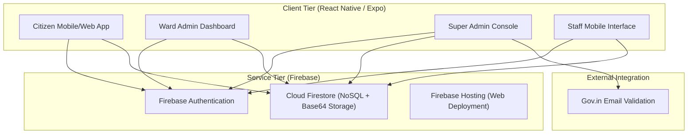
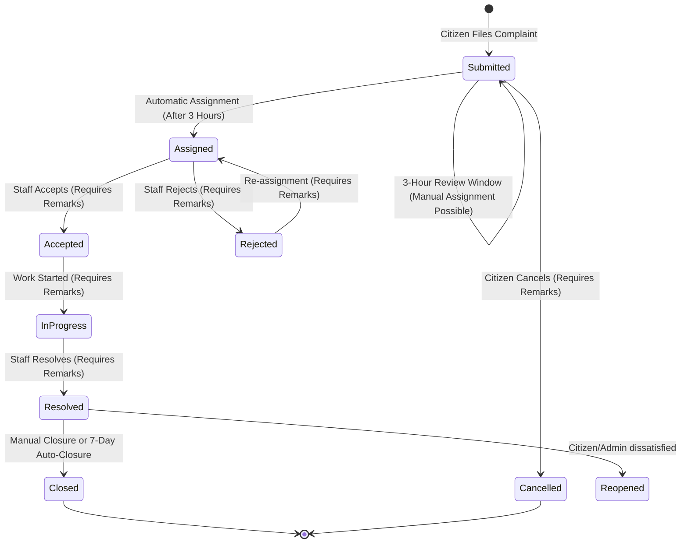
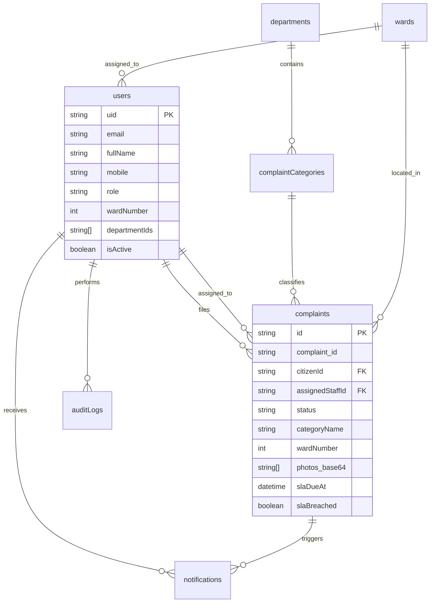

# Thrissur Corporation Citizen Complaint Management System
## Technical Project Proposal & Implementation Report

**Prepared For:** Thrissur Corporation Council  
**Prepared By:** Solution Architecture & Consulting Team  
**Version:** 1.0.0  
**Date:** August 3, 2026  

---

**Confidentiality Statement:**  
This document contains proprietary information and technical specifications related to the Thrissur Corporation Citizen Complaint Management System. It is intended solely for the use of the Thrissur Corporation Council for evaluation and administrative purposes. Unauthorized reproduction or distribution is prohibited.

---

## 1. Table of Contents
1. [Executive Summary](#2-executive-summary)
2. [Organization Overview](#3-organization-overview)
3. [Problem Statement](#4-problem-statement)
4. [Proposed Solution](#5-proposed-solution)
5. [Project Objectives](#6-project-objectives)
6. [Scope of the Project](#7-scope-of-the-project)
7. [System Architecture](#8-system-architecture)
8. [Technology Stack](#9-technology-stack)
9. [User Roles & Permissions](#10-user-roles--permissions)
10. [Authentication Module](#11-authentication-module)
11. [Citizen Registration Flow](#12-citizen-registration-flow)
12. [Citizen Dashboard](#13-citizen-dashboard)
13. [Complaint Management Module](#14-complaint-management-module)
14. [Complaint Workflow Lifecycle](#15-complaint-workflow-lifecycle)
15. [Ward Administration Module](#16-ward-administration-module)
16. [Staff Management Module](#17-staff-management-module)
17. [Super Administrator Module](#18-super-administrator-module)
18. [Reports & Analytics](#19-reports--analytics)
19. [Search & Filtering](#20-search--filtering)
20. [Firebase Database Documentation](#21-firebase-database-documentation)
21. [Security & Access Control](#22-security--access-control)
22. [Performance & Scalability](#23-performance--scalability)
23. [Future Enhancements](#24-future-enhancements)
24. [Conclusion](#25-conclusion)
25. [Annexure](#26-annexure)

---

## 2. Executive Summary
The **Thrissur Corporation Citizen Complaint Management System (CCMS)** is a comprehensive e-Governance solution designed to bridge the gap between citizens and municipal administration. The system provides a transparent, accountable, and efficient platform for filing, tracking, and resolving civic complaints. By leveraging modern cloud technology and mobile-first design, the CCMS ensures that every citizen's voice is heard and every issue is addressed within a defined Service Level Agreement (SLA).

---

## 3. Organization Overview
**Thrissur Corporation**, the municipal governing body for the city of Thrissur, Kerala, is committed to providing superior civic amenities to its residents. With the rapid urbanization and increasing demand for services, the Corporation recognized the need for a digital transformation in its grievance redressal mechanism to ensure timely resolution of issues like street lighting, sanitation, and infrastructure maintenance.

---

## 4. Problem Statement
The existing manual complaint management process faced several critical challenges:
- **Opacity**: Citizens had no real-time visibility into the status of their complaints.
- **Delayed Resolution**: Lack of automated assignment led to bottlenecks in work allocation.
- **Accountability Gaps**: Difficulty in tracking field staff performance and resolution time.
- **Administrative Burden**: Manual record-keeping consumed significant human resources.
- **Data Fragmentation**: No centralized repository for analysis of recurring civic issues.

---

## 5. Proposed Solution
The implemented CCMS is a multi-platform solution comprising:
- **Mobile Application**: A cross-platform React Native app for Citizens and Staff.
- **Web Portal**: A centralized administration console for Ward and Super Administrators.
- **Intelligent Backend**: Powered by Firebase for real-time data sync and notification delivery.
- **Automation Engine**: An advanced logic layer for automatic complaint assignment based on ward, department, and staff workload.

---

## 6. Project Objectives
- To provide citizens with a 24/7 digital platform for grievance registration.
- To automate the assignment of complaints to the most relevant field staff.
- To enforce accountability through real-time SLA tracking and breach monitoring.
- To provide administrators with data-driven insights through advanced analytics.
- To eliminate paper-based workflows and centralize all municipal grievance data.

---

## 7. Scope of the Project
### 7.1 Implemented Scope
- **Branding**: Integrated official Thrissur Corporation logo and custom splash screen for professional identity.
- **User Authentication**: Secure role-based login and registration with automated account cleanup and state propagation safety.
- **Complaint Lifecycle**: Full workflow from submission to closure with mandatory remarks for accountability.
- **Automatic Assignment**: Logic-based allocation of tasks to field staff with a 3-hour administrative review window before system-level triggering.
- **SLA Management**: Real-time monitoring of resolution deadlines.
- **Multimedia Support**: Innovative "Plan B" Base64 storage with integrated **Auto-Rescaling Engine**. Automatically optimizes and compresses photos to ensure 100% upload success regardless of file size.
- **Audit Trails**: Complete logging of every action performed in the system.

### 7.2 Excluded Scope
- Integration with external payment gateways (not required for grievance redressal).
- Public-facing live map of all active complaints (restricted for security).

### 7.3 Future Scope
- **AI-Based Categorization**: Using NLP to automatically categorize complaints from descriptions.
- **GIS Integration**: Mapping complaints to precise geographic coordinates for better field navigation.
- **Chatbot Support**: AI-driven assistant for basic citizen inquiries.

---

## 8. System Architecture
The system follows a modern Serverless Architecture using the Firebase suite.



---

## 9. Technology Stack
- **Framework**: React Native with Expo (Cross-platform Android/Web)
- **Programming Language**: TypeScript (Strict typing for reliability)
- **Backend-as-a-Service**: Firebase
    - **Authentication**: Email/Password based secure login with session state guarding.
    - **Cloud Firestore**: Real-time NoSQL database with optimized security rules for ownership and jurisdiction. Stores compressed Base64 multimedia for zero-fail reliability.
    - **Hosting**: Global CDN for web dashboard delivery with custom favicon support.
- **Navigation**: Expo Router (File-based routing) with Global Home Shortcut for multi-dashboard accessibility.
- **State Management**: React Context API (Auth and Theme)
- **Styling**: Custom Theme System with Light/Dark mode support.

---

## 10. User Roles & Permissions

| Role | Responsibilities | Key Permissions |
| :--- | :--- | :--- |
| **Citizen** | File and track personal complaints | Create Complaint, Add Comment, Reopen, Track Status |
| **Field Staff** | Resolve assigned complaints in the field | Accept/Reject Task, Update Progress, Upload Resolution Photos |
| **Ward Admin** | Monitor ward-level performance | Manual Assignment, Closure of Resolved Complaints, Staff Monitoring |
| **Super Admin** | System configuration and global oversight | Manage Wards/Depts, Global Analytics, Audit Logs, Metadata Config |
| **Read-Only Admin** | System auditing and observation | View-all access without modification rights |

---

## 11. Authentication Module
Implemented using **Firebase Authentication**, providing:
- **Secure Onboarding**: Registration with mobile and ward verification.
- **Safety Mechanisms**: 1000ms delay for authentication state settlement and automatic cleanup of Auth accounts if Firestore profile creation fails.
- **Role Detection**: Automatic redirection to appropriate dashboards upon login.
- **Session Persistence**: Secure token-based session management via React Native.
- **Password Management**: Integrated reset and update workflows.
- **Security**: Restricted registration for staff/admins via secondary administrative instances.

---

## 12. Citizen Registration Flow
1. **Details Entry**: Name, Email, Mobile, and Password.
2. **Ward Selection**: Citizen selects their resident ward from a pre-defined list.
3. **Account Creation**: Profile is created in Firestore `users` collection.
4. **Auto-Login**: Immediate redirection to the Citizen Home Dashboard.
5. **Onboarding**: Direct access to file the first complaint.

---

## 13. Citizen Dashboard
- **Home Screen**: Overview of active and resolved complaints.
- **New Complaint Button**: Floating action button for quick access.
- **Notification Center**: Real-time alerts on status changes.
- **Profile Section**: Management of personal details and ward information.

---

## 14. Complaint Management Module
- **Categorization**: Multi-level categorization (Sanitation, Electrical, etc.).
- **Smart ID Generation**: Unique identifiers (e.g., TC-123456) for easy tracking.
- **Evidence Upload**: Integrated **Auto-Rescaling Engine** supporting up to 3 optimized photos per complaint.
- **Timeline Tracking**: Visual representation of the complaint's journey with mandatory transition remarks.
- **Collaborative Comments**: Threaded discussion between Citizen, Admin, and Staff.

---

## 15. Complaint Workflow Lifecycle



---

## 16. Ward Administration Module
- **Ward Dashboard**: Real-time statistics of complaints in the assigned ward.
- **Assignment Queue**: Interface for manually assigning `Submitted` or `Rejected` complaints during the 3-hour window or after rejection.
- **Closure Portal**: Reviewing resolved complaints and field photos before final closure.
- **Staff Workload View**: Monitoring the active tasks of ward-specific field staff.

---

## 17. Staff Management Module
- **Performance Tracking**: Automatic calculation of resolution time and SLA compliance.
- **Workload Management**: Incremental counters for active tasks to prevent staff burnout.
- **Jurisdiction Control**: Staff can be assigned to specific wards or granted "Universal Access" for municipal-wide tasks.

---

## 18. Super Administrator Module
- **Department/Category Management**: Dynamic creation of municipal departments and complaint categories.
- **SLA Configuration**: Defining custom resolution hours for different types of issues.
- **Audit Logs**: Transparent logging of all administrative actions for accountability.
- **System Settings**: Global metadata configuration and app-wide maintenance controls.

---

## 19. Reports & Analytics
- **Summary Reports**: High-level view of total, resolved, and pending complaints.
- **SLA Breach Analysis**: Identification of departments or wards with low compliance.
- **Export Functionality**: Ability to export datasets for external audit and review.
- **Visual Analytics**: Charts and graphs representing complaint trends.

---

## 20. Search & Filtering
- **Multi-Criteria Search**: Smart search by exact Complaint ID (TC-XXXXXX), Mobile Number (10 digits), or Title keywords.
- **Advanced Filters**: Narrow down by Status, Ward, Department, or Staff Assignment.
- **Pagination**: Efficient loading of large datasets using Firestore cursors.

---

## 21. Firebase Database Documentation
### 21.1 Collections Overview
| Collection | Description |
| :--- | :--- |
| `users` | Unified storage for Citizens, Staff, and Admins. |
| `complaints` | Core collection for all grievance records (includes Base64 multimedia). |
| `departments` | Municipal department definitions. |
| `complaintCategories` | Specific complaint types linked to departments. |
| `wards` | Ward number and name definitions. |
| `auditLogs` | Immutable record of system transactions. |
| `notifications` | User-specific system alerts. |

---

## 22. Security & Access Control
- **Firestore Security Rules**: Strict path-based rules ensuring users only access their relevant data.
- **Role-Based Access (RBAC)**: Fine-grained permissions (e.g., Citizens cannot see other citizens' complaints).
- **Authentication Guards**: API-level checks to prevent unauthorized data mutations.
- **Data Integrity**: Server-side timestamps and atomic increments for critical counters.

---

## 23. Performance & Scalability
- **NoSQL Advantage**: High read/write throughput to handle municipal-scale data.
- **Lazy Loading**: Paginated data fetching for optimal mobile performance.
- **Multimedia Optimization**: Built-in Rescaling Engine (1200px max) and JPEG compression (0.5) for instant Firestore persistence.
- **Global Deployment**: Hosted on Firebase's global CDN for low-latency access.

---

## 24. Future Enhancements
- **Multi-lingual Support**: Implementation of Malayalam and Hindi interfaces for better inclusivity.
- **WhatsApp Integration**: Allowing citizens to file complaints via a official WhatsApp bot.
- **Supervisor Escalation**: Automatic escalation of breached complaints to senior municipal officers.

---

## 25. Conclusion
The **Thrissur Corporation Citizen Complaint Management System** is a production-ready, highly scalable, and transparent e-Governance solution. It successfully digitizes the grievance redressal lifecycle, providing a win-win platform for both the citizens of Thrissur and the Corporation administration. The implementation of automated workflows and real-time tracking ensures a more responsive and accountable municipal government.

---

## 26. Annexure
### Use Case Diagram
```mermaid
usecaseDiagram
    actor Citizen
    actor Staff
    actor "Ward Admin" as WardAdmin
    actor "Super Admin" as SuperAdmin

    Citizen --> (Register/Login)
    Citizen --> (File Complaint)
    Citizen --> (Track Complaint Status)
    Citizen --> (Add Comment/Feedback)
    Citizen --> (Reopen Resolved Complaint)

    Staff --> (View Assigned Tasks)
    Staff --> (Accept/Reject Assignment)
    Staff --> (Update Work Progress)
    Staff --> (Resolve Complaint)
    Staff --> (Upload Work Photos)

    WardAdmin --> (Monitor Ward Complaints)
    WardAdmin --> (Manually Assign Staff)
    WardAdmin --> (Close Resolved Complaints)
    WardAdmin --> (Manage Ward Staff)
    WardAdmin --> (View Ward Reports)

    SuperAdmin --> (Configure System Meta)
    SuperAdmin --> (Manage Wards/Departments)
    SuperAdmin --> (System-wide Analytics)
    SuperAdmin --> (Audit Trail Monitoring)
    SuperAdmin --> (Global SLA Tracking)
```

### Database Entity Relationship Diagram


---
**End of Proposal**
